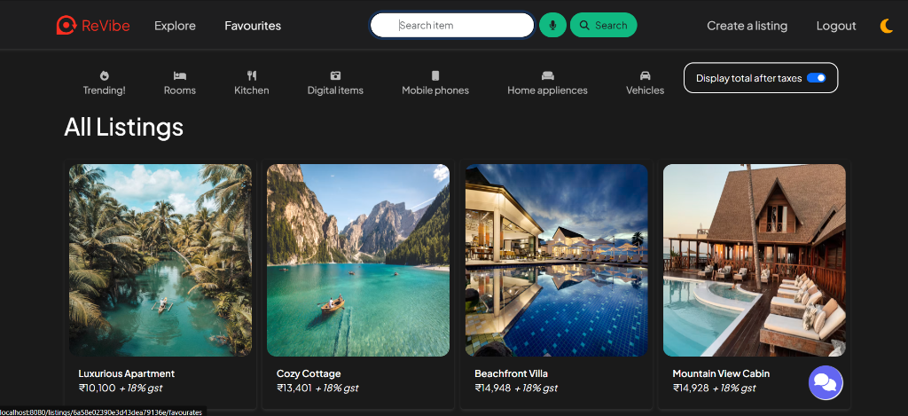

# ReVibe Deployment Documentation

This document describes the deployment architecture and execution commands for the ReVibe web application.

## 1. Containerized Deployment (Docker & Docker Compose)

The application is fully containerized using a lightweight Node.js 20 Alpine base image.

### Building and Running via Docker Compose
```bash
# Build the container image
make docker-build

# Launch the full stack (ReVibe Web + MongoDB)
docker compose up -d

# Verify container status and health
docker compose ps
```

### Endpoints
- Web Application: `http://localhost:8080/`
- Health Probe: `http://localhost:8080/health` (HTTP 200 `{"status":"ok"}`)
- Metrics Probe: `http://localhost:8080/metrics` (Prometheus exposition format)

---

## 2. Container Registry

Container images are automatically built and published to GitHub Packages Container Registry upon merges to `main`:
- Registry Target: `ghcr.io/skit-devops-2026/devops-24eskcs096:latest`

---

## 3. Cloud Deployment (Render)

The application includes `render.yaml` Blueprint for zero-friction cloud hosting on Render.
- Build Command: `cd server && npm ci`
- Start Command: `cd server && npm start`
- Live Endpoint: `https://revibe-24eskcs096.onrender.com`

---

## 4. Deployment Verification Evidence


